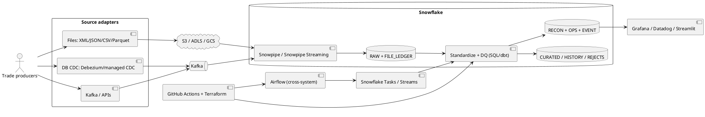

# Deutsche Bank – Enterprise Trade Data Platform

A Snowflake-centric, metadata-driven reference implementation for multi-source, high-volume trade ingestion, validation, versioning, reconciliation and observability.

> This is a deployable starter/case-study reference, not a production-certified banking platform. Adapt cloud storage integrations, identity, encryption, retention, regulatory controls, SLAs and network policies to the bank's standards.

## Architecture



## Key design decisions

1. **Adapter pattern:** source-specific adapters parse XML, fixed-width, CSV, database CDC and APIs into a canonical event envelope. The raw payload and source metadata remain available for replay/audit.
2. **Separate ingestion paths:** cloud files use external stages + Snowpipe auto-ingest; Kafka uses Snowpipe Streaming or a supported Kafka connector. Do not make file ingestion wait for batch orchestration.
3. **File completeness:** producers publish a manifest/`_SUCCESS` marker only after all parts are uploaded. The manifest contains expected row count, file count, byte count and optionally SHA-256. A manifest is the commit signal, not the arrival of an individual data file.
4. **Idempotency:** business event ID, source event ID and file identity are retained. A durable file ledger and event deduplication protect beyond Snowflake's finite load-history window.
5. **Fast DQ:** set-based SQL/dbt tests are the default. Snowpark is reserved for complex parsing/normalization that is awkward in SQL. Avoid row-by-row UDFs.
6. **Trade lifecycle:** classify all events, retain rejected events, apply version rules in a serialized/partitioned transaction, preserve history and derive expiry at query time or with a scheduled status refresh.
7. **Reconciliation:** compare manifest expectations, ingested rows, accepted/rejected counts and financial control totals. Do not equate file-loaded with batch-complete.
8. **Orchestration:** Snowflake Tasks/Streams handle in-platform dependencies. Airflow handles source-side dependencies, manifest waiting, dbt invocation, SLA checks and external notifications.

## Source support matrix

| Source | Recommended adapter | Snowflake entry |
|---|---|---|
| JSON/JSONL | Direct producer or file adapter | Snowpipe + VARIANT |
| CSV | Validate header/schema; map to canonical envelope | Snowpipe/COPY |
| XML | XML parser/adapter; preserve original XML | Canonical JSON or XML file format |
| Fixed-width | Versioned layout parser | Canonical JSON |
| Parquet | Direct staged Parquet; map to canonical fields | Snowpipe/COPY |
| Oracle/SQL Server/Postgres | Debezium or managed CDC | Kafka / staged micro-batches |
| Kafka | Kafka connector or HP Snowpipe Streaming SDK | Streaming pipe |
| REST API | Rate-limited API adapter with cursor checkpoint | Canonical JSON files/events |

## Repository layout

```text
sql/                 Snowflake bootstrap, ingestion, DQ, reconciliation, monitoring
 dbt_project/        dbt project and tests
 scripts/             Multi-format sample generator and manifest writer
 airflow/dags/        Cross-system orchestration example
 kafka/               Kafka Connect example configuration
 terraform/           Snowflake infrastructure starter
 .github/workflows/   CI validation
 docs/                Runbook, scaling, architecture and interview notes
 tests/               Local unit tests
```

## Quick start (Snowflake)

1. Create a Snowflake role/service user and configure key-pair auth. Never commit secrets.
2. Install dbt with `pip install -r requirements-dbt.txt`; install Airflow and its Snowflake provider in a managed Airflow environment using `requirements-airflow.txt`.
3. Run `sql/00_bootstrap.sql` with an admin/deployment role. It creates database, schemas, warehouses, file formats, tables, stages (placeholder URL), pipes and procedures.
4. Replace `@DB_TRADE_DB.RAW.TRADE_EXT_STAGE` URL and storage integration with your cloud provider configuration. Configure event notifications and pipe auto-ingest.
5. Generate sample files: `python scripts/generate_trades.py --out ./sample_data --rows 10000 --format all --batch-id DEMO-001`.
6. Upload data files to the stage path. Upload the manifest last, then call `CALL DB_TRADE_DB.OPS.REGISTER_MANIFEST(PARSE_JSON('<manifest-json>'));`. For local/internal-stage demos use `PUT` then `COPY INTO`; production should use cloud object storage and event notifications.
7. Run dbt: `cd dbt_project && dbt deps && dbt build --vars '{"batch_id":"DEMO-001"}'`.
8. Run reconciliation SQL in `sql/40_reconciliation.sql`.

## Important deployment notes

- The sample pipe demonstrates canonical JSONL ingestion. Configure one pipe per source path/file format where needed, or normalize with source adapters before landing. Avoid a single pipe trying to parse unrelated file encodings.
- For streaming, use Snowpipe Streaming high-performance architecture only when the account/region/cloud and client SDK support it. The Kafka connector path is a valid alternative.
- Snowflake pipe load order is not guaranteed. Trade version ordering must be determined by event sequence/version, never arrival order.
- The SQL example serializes the apply procedure by batch. For parallel production processing, partition/serialize by `HASH(trade_id)` or use a controlled single-writer apply queue. Concurrent MERGEs on overlapping keys need explicit concurrency design.
- Same-version replacement is implemented as deterministic latest-event-wins. Define a source precedence and tie-breaker with business owners.
- Maturity before business date is rejected; maturity on/before current date is expired. Confirm timezone and market-calendar rules with the business.
- Account Usage views have latency. Use Information Schema/table functions for near-real-time operations and Account Usage for historical analysis.

## Local tests

```bash
python -m pip install -r requirements-dev.txt
pytest -q
```

## CI/CD

GitHub Actions runs Python tests and SQL/dbt static checks. Configure GitHub repository secrets for Snowflake deployment. Promote dev → test → prod using separate roles, databases/schemas, storage integrations and approval gates. Terraform is intentionally a starter: storage notification wiring is cloud-specific and should be managed in the cloud account module.
