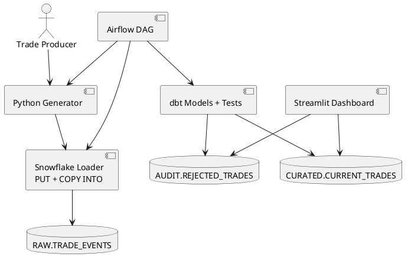

# DWS Trade Processing Pipeline — Snowflake + dbt

Git-ready case-study implementation with Python trade generation, Snowflake stage + `COPY INTO`, dbt validation and version handling, Airflow orchestration, Terraform starter IaC, GitHub Actions CI, and Streamlit monitoring.

## Architecture



## Business rules

- `trade_id` is the business key and `version` is a positive integer.
- Lower version than the currently stored version is rejected as `STALE_VERSION`.
- Same version replaces the current record as `SAME_VERSION_REPLACEMENT`, per the case-study requirement.
- Higher version replaces the current record.
- Maturity date earlier than processing date is rejected as `MATURITY_BEFORE_TODAY`.
- Current trades whose maturity date passes are reported as `EXPIRED`; they are not physically deleted.
- Missing required fields, invalid side, non-positive quantity/price, and invalid currency are rejected.
- Lower versions in the same batch are rejected as `SUPERSEDED_IN_BATCH`.
- Rejected records are stored with reason, source metadata, event ID, and raw payload.

**Concurrency note:** the example Airflow DAG sets `max_active_runs=1` to serialize batches. For concurrent producers, use a transactional stored procedure or serialize by `trade_id`; dbt models alone do not make a multi-model build atomic.

## Quick start

1. Run `sql/bootstrap.sql` in Snowflake using an appropriately privileged setup role.
2. Copy `.env.example` to `.env` and enter connection settings. Never commit credentials.
3. Install dependencies:
   ```bash
   python -m venv .venv
   # Windows: .venv\Scripts\Activate.ps1
   # macOS/Linux: source .venv/bin/activate
   pip install -r requirements.txt
   ```
4. Generate and load data:
   ```bash
   python scripts/generate_trades.py --output data/trades.jsonl --count 100 --batch-id demo-batch
   python scripts/load_to_snowflake.py --file data/trades.jsonl
   ```
5. Configure dbt:
   ```bash
   cp dbt_project/profiles.yml.example dbt_project/profiles.yml
   cd dbt_project
   dbt deps
   dbt debug
   dbt build --vars '{"batch_id":"demo-batch"}'
   cd ..
   ```
6. Dashboard:
   ```bash
   streamlit run streamlit_app/app.py
   ```
7. Run unit tests: `pytest -q`.

The loader uses an internal Snowflake stage and `COPY INTO`. For production file arrival, consider cloud storage stages + Snowpipe auto-ingest or Snowpipe Streaming where appropriate.

## Monitoring and scaling

See `docs/OPERATIONS.md` for file arrival delays, data-quality failures, retries, Snowflake account usage views, alerting, and a 10,000x scale strategy.

## Push to public GitHub

Create an empty repository on GitHub, then run from this folder:

```bash
git init
git add .
git commit -m "Initial DWS trade pipeline case study"
git branch -M main
git remote add origin https://github.com/<YOUR_USERNAME>/<YOUR_REPO>.git
git push -u origin main
```

Replace placeholders with your real GitHub username/repository. I have prepared the project files, but have not published a repository to your GitHub account.

```bash
git init
git add .
git commit -m "Initial DWS trade pipeline case study"
git branch -M main
git remote add origin https://github.com/skEdison/DB_casestudy.git
git push -u origin main
```
