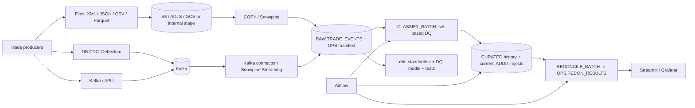

# Deutsche Bank – Enterprise Trade Data Platform

A Snowflake-centric, metadata-driven reference implementation for multi-source, high-volume trade ingestion, validation, versioning, reconciliation and observability.

> This is a deployable starter/case-study reference, not a production-certified banking platform. Adapt cloud storage integrations, identity, encryption, retention, regulatory controls, SLAs and network policies to the bank's standards.

## Architecture



## Key design decisions

1. **Adapter pattern:** source-specific adapters parse XML, fixed-width, CSV, database CDC and APIs into a canonical event envelope. The raw payload and source metadata remain available for replay/audit.
2. **Separate ingestion paths:** cloud files use external stages + Snowpipe auto-ingest; Kafka uses Snowpipe Streaming or a supported Kafka connector. Do not make file ingestion wait for batch orchestration.
3. **File completeness:** producers publish a manifest/`_SUCCESS` marker only after all parts are uploaded. The manifest contains expected row count, file count, byte count and optionally SHA-256. A manifest is the commit signal, not the arrival of an individual data file.
4. **Idempotency:** business event ID, source event ID and file identity are retained. A durable file ledger and event deduplication protect beyond Snowflake's finite load-history window.
5. **Fast DQ:** set-based SQL/dbt tests are the default. Snowpark is reserved for complex parsing/normalization that is awkward in SQL. Avoid row-by-row UDFs.
6. **Trade lifecycle:** classify all events, retain rejected events, apply version rules in a serialized/partitioned transaction, preserve history and derive expiry at query time or with a scheduled status refresh.
7. **Reconciliation:** compare manifest expectations, ingested rows, accepted/rejected counts and financial control totals. Do not equate file-loaded with batch-complete.
8. **Orchestration:** Snowflake Tasks/Streams handle in-platform dependencies. Airflow handles source-side dependencies, manifest waiting, dbt invocation, SLA checks and external notifications.

## Source support matrix

| Source | Recommended adapter | Snowflake entry |
|---|---|---|
| JSON/JSONL | Direct producer or file adapter | Snowpipe + VARIANT |
| CSV | Validate header/schema; map to canonical envelope | Snowpipe/COPY |
| XML | XML parser/adapter; preserve original XML | Canonical JSON or XML file format |
| Fixed-width | Versioned layout parser | Canonical JSON |
| Parquet | Direct staged Parquet; map to canonical fields | Snowpipe/COPY |
| Oracle/SQL Server/Postgres | Debezium or managed CDC | Kafka / staged micro-batches |
| Kafka | Kafka connector or HP Snowpipe Streaming SDK | Streaming pipe |
| REST API | Rate-limited API adapter with cursor checkpoint | Canonical JSON files/events |

## Repository layout

```text
sql/                 00_bootstrap, 20_trade_apply, 30_monitoring, 40_reconciliation, 50_alerts_and_dq, 60_grants
dbt_project/         staging view, DQ model, tests (ci/ has a dummy profile for `dbt parse`)
scripts/             generate_trades.py (sample batches + manifest), load_to_snowflake.py (verify + load + register)
airflow/dags/        trade_platform.py (batch DAG), trade_pipeline_dag.py (demo end-to-end)
streamlit_app/       monitoring dashboard
kafka/               Kafka Connect example configuration
terraform/           Snowflake infrastructure starter
.github/workflows/   CI: tests, dbt parse, terraform validate
docs/                Runbook, decisions, interview walkthrough, review notes
tests/               Unit and repo-consistency tests
```

## Quick start (Snowflake)

1. Create a Snowflake service user with key-pair auth; copy `.env.example` to `.env` (never commit it).
2. `make setup` (Python deps). Install dbt separately: `pip install -r requirements-dbt.txt`; copy `dbt_project/profiles.yml.example` to `dbt_project/profiles.yml`.
3. In Snowflake run, in order: `sql/00_bootstrap.sql`, `sql/20_trade_apply.sql`, `sql/40_reconciliation.sql`, `sql/60_grants.sql` (grant the roles to your service users).
4. `make generate BATCH=DEMO-001` writes JSONL + CSV + XML files (rows split across them, with planted bad records), a manifest and `_SUCCESS`.
5. `make verify BATCH=DEMO-001` checks files against the manifest (size, SHA-256, record count, UTF-8) without touching Snowflake.
6. `make load BATCH=DEMO-001` verifies, PUTs to the internal stage, COPYs with a per-format mapping, and registers the manifest only if loaded rows match.
7. Process the batch: `CALL DB_TRADE_DB.STANDARD.CLASSIFY_BATCH('DEMO-001'); CALL DB_TRADE_DB.CURATED.APPLY_BATCH('DEMO-001'); CALL DB_TRADE_DB.OPS.RECONCILE_BATCH('DEMO-001');` (Airflow does this, see `airflow/dags/trade_platform.py`), then `cd dbt_project && dbt build --vars '{"batch_id":"DEMO-001"}'`.
8. `make dashboard` for the Streamlit monitor.

For production sources use the same RAW table: `python scripts/load_to_snowflake.py --print-sql xml` prints the COPY mapping for a Snowpipe definition; Kafka/CDC use the connector in `kafka/`.

## Important deployment notes

- `APPLY_BATCH` refuses to run unless the batch was classified and RAW is unchanged since. Duplicate deliveries are suppressed (one copy kept); conflicting duplicates and other rule failures are rejected with the original payload.
- Pipes need a storage/notification integration, so they are templates, not created by the bootstrap. One pipe per file format.
- For streaming, use Snowpipe Streaming high-performance architecture only when your account/region/SDK support it; the Kafka connector is a valid alternative.
- Pipe load order is not guaranteed. Trade version ordering uses version and source sequence, never arrival order.
- The apply procedure serializes by batch. For parallel processing partition by `HASH(trade_id)` or use a single-writer queue.
- Same-version replacement is deterministic latest-event-wins (source sequence). Agree source precedence with the business.
- A maturity date earlier than today is rejected on arrival; a stored trade whose maturity has since passed becomes EXPIRED (maturity today is still ACTIVE). Confirm timezone and market-calendar rules with the business.
- Rules are set-based SQL in one pass. Run `CLASSIFY_BATCH` on `TRADE_TRANSFORM_WH` and size that warehouse up for large batches; Snowpark is only worth adding for parsing that is awkward in SQL.
- Account Usage views have latency; use Information Schema for near-real-time operations.

## Local tests

```bash
make setup
make test
```


- The sample pipe demonstrates canonical JSONL ingestion. Configure one pipe per source path/file format where needed, or normalize with source adapters before landing. Avoid a single pipe trying to parse unrelated file encodings.
- For streaming, use Snowpipe Streaming high-performance architecture only when the account/region/cloud and client SDK support it. The Kafka connector path is a valid alternative.
- Snowflake pipe load order is not guaranteed. Trade version ordering must be determined by event sequence/version, never arrival order.
- The SQL example serializes the apply procedure by batch. For parallel production processing, partition/serialize by `HASH(trade_id)` or use a controlled single-writer apply queue. Concurrent MERGEs on overlapping keys need explicit concurrency design.
- Same-version replacement is implemented as deterministic latest-event-wins. Define a source precedence and tie-breaker with business owners.
- Maturity before business date is rejected; maturity on/before current date is expired. Confirm timezone and market-calendar rules with the business.
- Account Usage views have latency. Use Information Schema/table functions for near-real-time operations and Account Usage for historical analysis.

## Local tests

```bash
python -m pip install -r requirements-dev.txt
pytest -q
```

## CI/CD

GitHub Actions runs Python tests, `dbt parse` (dummy profile) and `terraform validate`. Configure GitHub repository secrets for Snowflake deployment. Promote dev → test → prod using separate roles, databases/schemas, storage integrations and approval gates. Terraform is intentionally a starter: storage notification wiring is cloud-specific and should be managed in the cloud account module.
